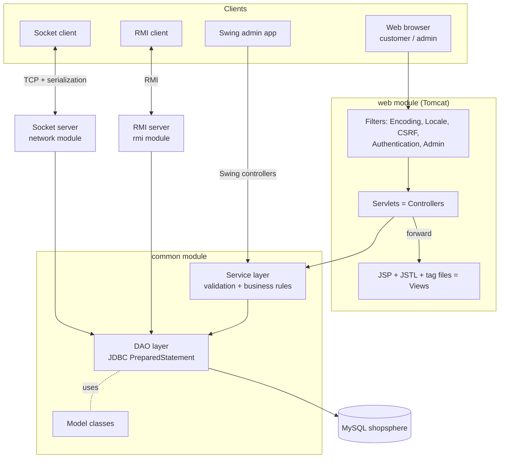
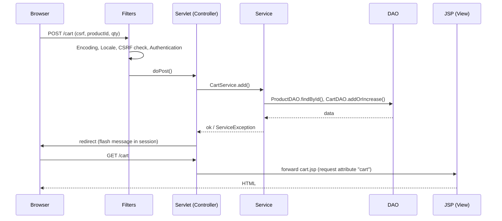
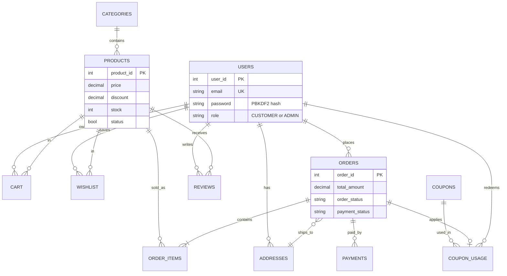
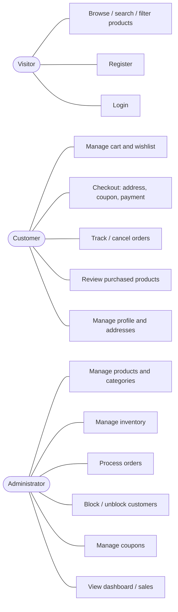
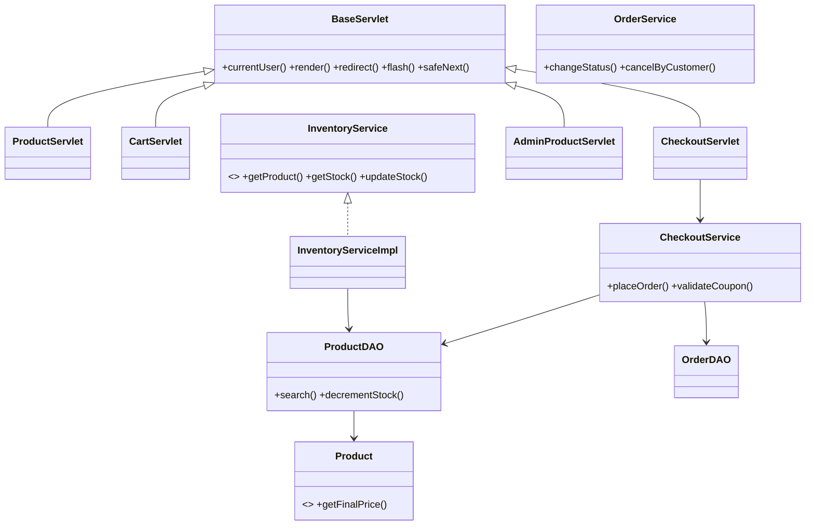

# ShopSphere - Architecture and Design

(Diagrams are written in Mermaid. They render on GitHub, in VS Code (Markdown Preview Mermaid) and at https://mermaid.live.)

## 1. N-tier architecture



Rules: a JSP never touches the database; a servlet never contains SQL; a DAO contains no business rules.

## 2. MVC in the web module



## 3. Entity-relationship diagram



## 4. Use cases



## 5. Checkout transaction

```mermaid
sequenceDiagram
    participant Co as CheckoutService
    participant DB as MySQL (one Connection, autoCommit=false)
    Co->>DB: read cart + current product prices
    Co->>Co: validate stock, coupon; calculate subtotal, discount, total
    Co->>DB: INSERT orders
    loop each cart line
        Co->>DB: UPDATE products SET stock = stock - ? WHERE stock >= ?
        Co->>DB: INSERT order_items (price at purchase time)
    end
    Co->>DB: INSERT payments, INSERT coupon_usage, DELETE cart
    alt every step succeeded
        Co->>DB: COMMIT
    else any failure
        Co->>DB: ROLLBACK (no half-created orders, stock restored)
    end
```

## 6. Key classes



## 7. Security design summary

| Threat | Defence |
|---|---|
| SQL injection | `PreparedStatement` only; sort order chosen from a whitelist |
| XSS | all user data printed with `<c:out>`; `HttpOnly` cookies |
| CSRF | per-session token checked by `CsrfFilter` on every POST |
| Session fixation | `changeSessionId()` after login |
| Password theft | PBKDF2-HMAC-SHA256, random salt, 65 536 iterations, constant-time compare |
| Broken access control | `AuthenticationFilter`, `AdminFilter`, ownership checks in `OrderService` / `AddressDAO` |
| Price tampering | totals always recalculated on the server |
| Overselling / double-spend | guarded stock update inside a transaction |
| Open redirect | `safeNext()` allows only same-site paths |
| Unsafe deserialization | `ObjectInputFilter` allow-list in the socket client |
